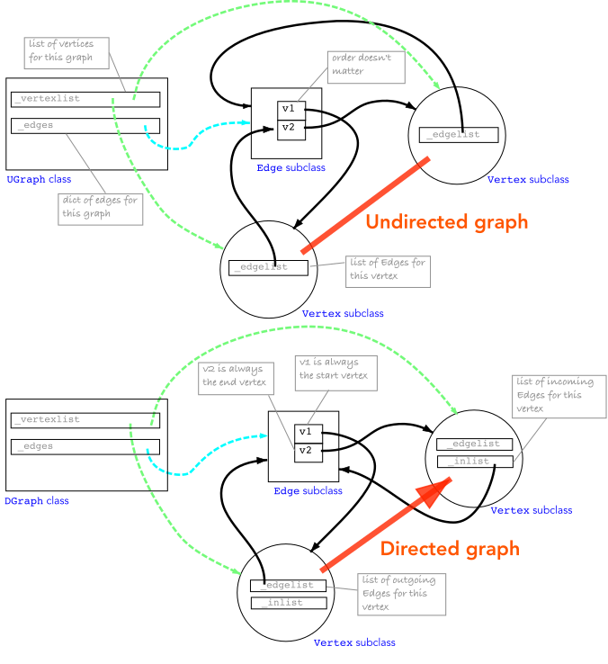

Edges & Vertices
=================

Underlying data structures
----------------------------

The graph class maintains a list of vertices and a dict of edges. For the undirected case,
each vertex maintains
a list of edges that connect to it, and each edge maintains a reference to the two
vertices it connects. In the case of a loop, the edge appears twice in the vertex's edge list.
For the directed case, each vertex maintains two edge lists: a list of outgoing edges and a list of incoming edges.

The graph class provides methods for adding and removing vertices and edges (see :doc:`modification`)
and for querying its structure (see :doc:`analysis`).

What a vertex holds
~~~~~~~~~~~~~~~~~~~~

Each vertex has **two** private edge lists, plus a back-pointer to its graph.

.. list-table::
   :header-rows: 1
   :widths: 15 55 30

   * - Attribute
     - For undirected graphs
     - For directed graphs
   * - ``_edgelist``
     - the edges *incident on* it
     - the edges *leaving* it
   * - ``_inlist``
     - empty
     - the edges *entering* it
   * - ``_graph``
     - the graph it belongs to (``None`` if standalone)
     - the graph it belongs to (``None`` if standalone)

Every list entry is a reference to the same :class:`~pgraph.PGraph.Edge` class object, and
there is exactly one edge object for each edge in the graph.

* **Undirected:** one list does everything, since an undirected edge is both "out"
  and "in".  That is also why a loop is stored twice, once for each end, and why it
  counts 2 towards ``degree``.
* **Directed:** the two lists are the out-list and the in-list.  A loop sits once in
  each, so ``degree`` (in + out) is 2 there too.

An example, as lists
~~~~~~~~~~~~~~~~~~~~~~

For these simple graphs

.. plot::
   :include-source: no
   :alt: the example graph drawn as an undirected and as a directed graph: two parallel edges e1 and e2 from a to b, e3 from b to c and a loop e4 on c

   import matplotlib.pyplot as plt
   from matplotlib.patches import Circle, FancyArrowPatch

   pos = {"a": (0.0, 0.0), "b": (2.0, 0.0), "c": (4.0, 0.0)}
   # (name, from, to, curvature, label offset): e1 and e2 are parallel, drawn
   # as two arcs curving to either side
   edges = [("e1", "a", "b", 0.3, (0, 0.5)), ("e2", "a", "b", -0.3, (0, -0.5)),
            ("e3", "b", "c", 0, (0, 0.18))]

   fig, axs = plt.subplots(1, 2, figsize=(9, 2.3))
   for ax, is_directed, title in zip(axs, (False, True), ("UGraph", "DGraph")):
       style = "-|>" if is_directed else "-"
       for name, p, q, rad, (dx, dy) in edges:
           ax.add_patch(FancyArrowPatch(pos[p], pos[q], arrowstyle=style, mutation_scale=16,
                                        connectionstyle=f"arc3,rad={rad}", shrinkA=15, shrinkB=15,
                                        color="0.15", lw=1.6))
           mx = (pos[p][0] + pos[q][0]) / 2 + dx
           my = (pos[p][1] + pos[q][1]) / 2 + dy
           ax.text(mx, my, name, ha="center", va="center", fontsize=10, color="0.15")
       x, y = pos["c"]  # e4: a loop, an edge from c to itself
       ax.add_patch(FancyArrowPatch((x - 0.15, y + 0.15), (x + 0.15, y + 0.15), arrowstyle=style,
                                    mutation_scale=16, connectionstyle="arc3,rad=-1.8",
                                    color="0.15", lw=1.6))
       ax.text(x, y + 0.62, "e4", ha="center", va="center", fontsize=10, color="0.15")
       for name, (x, y) in pos.items():
           ax.add_patch(Circle((x, y), 0.2, fc="#1f77b4", ec="none", zorder=3))
           ax.text(x, y, name, ha="center", va="center", color="white", fontsize=11, zorder=4)
       ax.set_xlim(-0.6, 4.6)
       ax.set_ylim(-0.8, 0.95)
       ax.set_aspect("equal")
       ax.axis("off")
       ax.set_title(title, fontsize=11)
   fig.tight_layout()

The vertices ``a``, ``b`` and ``c`` and edges ``e1`` and ``e2`` are added in that order.
The resulting vertex lists are

.. list-table::
   :header-rows: 1
   :widths: 10 30 30 30

   * - Vertex name
     - ``UGraph`` ``_edgelist``
     - ``DGraph`` ``_edgelist``
     - ``DGraph`` ``_inlist``
   * - ``a``
     - ``[e1, e2]``
     - ``[e1, e2]``
     - ``[]``
   * - ``b``
     - ``[e1, e2, e3]``
     - ``[e3]``
     - ``[e1, e2]``
   * - ``c``
     - ``[e3, e4, e4]``
     - ``[e4]``
     - ``[e3, e4]``

The graph also keeps **every edge once** in ``graph._edges`` (an insertion-ordered
dict, so ``[e1, e2, e3, e4]``).

The public view of those lists
~~~~~~~~~~~~~~~~~~~~~~~~~~~~~~~

.. list-table::
   :header-rows: 1
   :widths: 30 35 35

   * - Method
     - Returns for ``UGraph``
     - Returns for ``DGraph``
   * - ``edges()``, ``out_edges()``
     - a copy of ``_edgelist``
     - a copy of ``_edgelist`` 
   * - ``in_edges()``
     - a copy of ``_edgelist``
     - a copy of ``_inlist`` 
   * - ``degree``
     - ``len(_edgelist)``
     - ``len(_edgelist) + len(_inlist)``
   * - ``in_degree``
     - ``len(_edgelist)``
     - ``len(_inlist)``
   * - ``out_degree``
     - ``len(_edgelist)``
     - ``len(_edgelist)``
   * - ``adjacent()``
     - the far end of each edge in ``_edgelist``
     - the far end of each edge in ``_edgelist``
   * - ``incidences()``
     - ``adjacent()`` paired with ``out_edges()``
     - ``adjacent()`` paired with ``out_edges()``

All are returned in the order the edges were connected.

Working with vertices and edges directly
-----------------------------------------

In the earlier examples we did not explicitly create vertices or edges, but we
can do so if we want to. The graph classes provide methods to create vertices and edges,
and to add them to the graph.

.. runblock:: pycon
   :session:

   >>> from pgraph import UGraph, Vertex, Edge
   >>> import numpy as np
   >>> g = UGraph()

Next, we will explicitly create two vertices

.. runblock:: pycon
   :session:

   >>> v1 = Vertex(np.random.rand(2))
   >>> v2 = Vertex(np.random.rand(2))

and then add them to the graph

.. runblock:: pycon
   :session:

   >>> g.add_vertex(v1)
   >>> g.add_vertex(v2)

Our graph now has two vertices, but no edges

.. runblock:: pycon
   :session:

   >>> print(g)

We can explicitly create an edge between the two vertices

.. runblock:: pycon
   :session:

   >>> e = Edge(v1, v2)

and then add it to the graph

.. runblock:: pycon
   :session:

   >>> g.add_edge(e)
   >>> print(g)

Creating the edge and then adding it to the graph, as above, is equivalent to

.. code-block:: python

   >>> e = Edge()
   >>> e.connect(v1, v2)

Alternatively, we can create a vertex and *connect* it to an existing vertex, which will implicitly create an edge between the two vertices and add it to the graph.

.. runblock:: pycon
   :session:

   >>> v3 = Vertex(np.random.rand(2))
   >>> g.add_vertex(v3)
   >>> v2.connect(v3)
   >>> print(g)

The ``connect`` method of the vertex class creates an edge between the two
vertices and adds it to the graph. The two vertices must have been added to the same graph for the edge to be created.
The ``connect`` method is the same for directed and undirected graphs: the graph decides how the edge is
recorded at its vertices.

.. note:: Wherever a vertex or edge is required, a subclass of the appropriate base class can be used. For example, we can create a subclass of ``Vertex`` called ``MyVertex`` and a subclass of ``Edge`` called ``MyEdge`` and then create a new graph using these classes, by passing them as the ``vertex_class`` and ``edge_class`` arguments of the graph constructor.

The Vertex class
-----------------

.. autoclass:: pgraph.PGraph.Vertex
   :show-inheritance:
   :special-members: __init__

The Edge class
-----------------

.. autoclass:: pgraph.PGraph.Edge
   :show-inheritance:
   :members:
   :special-members: __init__

